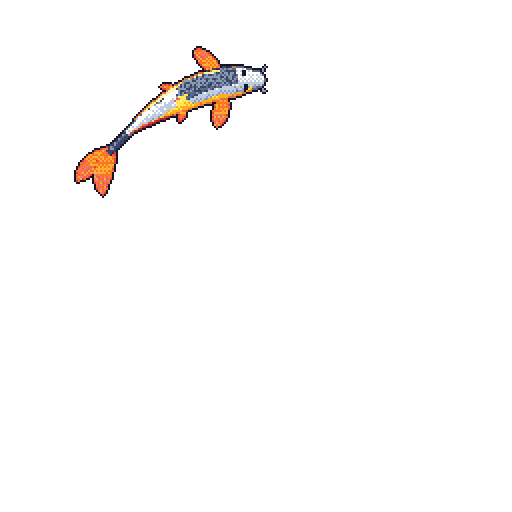

# DONNAVAN SOUZA

**Computer Science student @ UFC** · Fortaleza, Brazil

[GitHub](https://github.com/donnavansouza) · [University](https://www.ufc.br/)

---

I'm interested in **AI, machine learning, and software engineering** — especially responsible AI and fairness in large language models. Currently working with **Kunumi × UFC**.

### Things I’ve worked on

- **Responsible AI:** fairness evaluation and bias in LLMs.
- **IoT + ML:** sensor data and machine learning for diabetic-foot-care research at GREat / PIBIC.
- **UFCode:** full-stack development for a gamified programming-education platform.

### Toolbox

`Python` `PyTorch` `TensorFlow` `Scikit-learn` `C++` `JavaScript` `React` `Node.js`

### My little GitHub companion

### A long time ago, in a repository far, far away...

Click the logo to launch the Star Wars opening crawl.

### Off-screen interests

Games · Electric guitar · Star Wars · Blade Runner · The Lord of the Rings · Corinthians

---

Blade Runner GIF: shared by the community in <a href="https://github.com/hackwithdev/pixelartgifs">pixelartgifs</a> (artwork credited to its original creator). Star Wars crawl by <a href="https://github.com/Joe-Bentley/SW-Scrolling-Animations">Joe-Bentley</a>.
