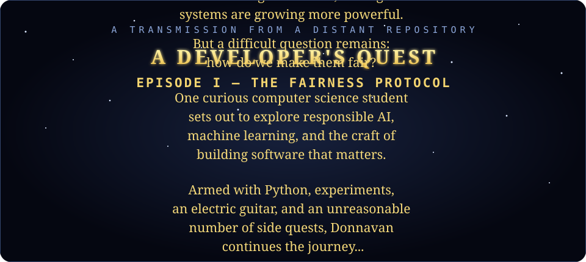
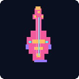

# DONNAVAN SOUZA

### PLAYER 01 · BUILDER OF THINGS · COLLECTOR OF SIDE QUESTS

**CS student @ UFC** · Fortaleza, Brazil

[GitHub](https://github.com/donnavansouza) · [UFC](https://www.ufc.br/)

---

## 🎮 SELECT YOUR QUEST

**CURRENT MISSION — Responsible AI**

Exploring fairness in AI and large language models with **Kunumi × UFC**. Interested in how we make intelligent systems more useful, more accountable, and less unfair.

**SIDE QUESTS COMPLETED**

- **IoT + machine learning:** Worked on a diabetic-foot-care project involving sensor data and ML models at GREat / PIBIC.
- **Programming education:** Helped build features for UFCode, a gamified programming-logic platform, using React and Node.js.

## 🧰 INVENTORY

<code>Python</code> <code>PyTorch</code> <code>TensorFlow</code> <code>Scikit-learn</code> <code>C++</code> <code>JavaScript</code> <code>React</code> <code>Node.js</code>

## 🐟 COMPANION

A tiny koi, redrawn from my public GitHub activity. Check back for its next swim.

## 🎸 PLAYER LORE

When I'm not debugging something, I'm probably playing games, learning electric guitar, or revisiting a galaxy far, far away. Also partial to neon-noir futures, Middle-earth, and Corinthians.

Soundtrack: electric guitar · Visual mood: space opera meets rainy neon streets

**MAY THE FORCE BE WITH YOUR PULL REQUESTS.**

---

Visual experiments inspired by [SWcrawl](https://github.com/PurpaFur/SWcrawl), [Scanlines](https://github.com/collidingScopes/scanlines), and [RyMe.md](https://ryme.md/). The profile artwork here is original SVG.
